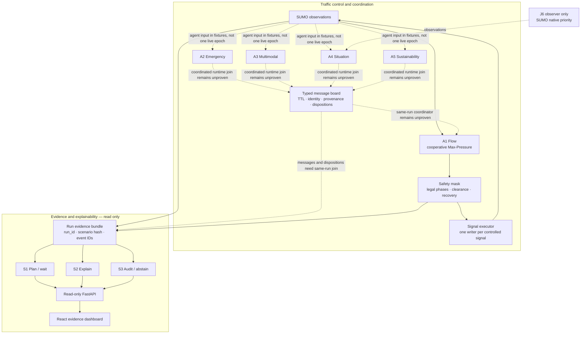
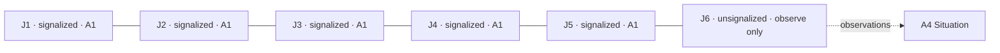
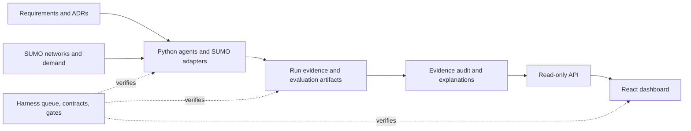

# CoFlow-5 Synapse

CoFlow-5 is a SUMO traffic-control research prototype. Five bounded traffic agents share evidence and advice; **A1 is the only agent allowed to request a signal change**. A deterministic safety layer validates every change. Synapse explains and audits saved run evidence; it never controls SUMO.

The project asks: **How can cooperating agents improve traffic decisions while keeping them safe, explainable, and measurable?** We study that question in a controlled SUMO benchmark, then aim to demonstrate a bounded six-junction Tunis subnetwork. The Tunis showcase is not a city-wide model or a claim about observed real-world traffic.

## Start here

| I want to… | Start with… |
|---|---|
| See the system design and agent boundaries | [Architecture overview](#how-the-system-works) and [agent roles](#why-there-are-multiple-agents) |
| Watch SUMO traffic | [Run the simulator](#run-the-simulator) |
| Explore the read-only evidence dashboard | [Run the dashboard](#open-the-evidence-dashboard) |
| Understand what is done and what remains | [Project status](#project-status) and [`harness/queue.tsv`](harness/queue.tsv) |
| Work on the code safely | [`AGENT_GUIDE.md`](AGENT_GUIDE.md), then [`docs/harness/how-it-works.md`](docs/harness/how-it-works.md) |

## Why this project exists

Traffic decisions affect people with different needs: drivers, pedestrians, transit riders, emergency services, and nearby communities. A single signal controller cannot treat every request as equally urgent, and an unrestricted AI controller would make safety and accountability hard to establish.

CoFlow-5 separates those concerns. Specialist agents provide bounded, typed advice. A1 weighs valid advice against traffic pressure and legal signal phases. The safety layer guards the only write path. Finally, a frozen evidence bundle records what happened so an operator can inspect the decision and its limits.

```mermaid
flowchart LR
    People[Road users and operators] --> Needs[Competing mobility and safety needs]
    Needs --> Agents[Five bounded traffic agents]
    Agents --> Safe[A1 plus deterministic safety]
    Safe --> Traffic[SUMO traffic simulation]
    Traffic --> Evidence[Measured run evidence]
    Evidence --> Explain[Synapse explains, audits, or abstains]
    Explain --> Operator[Operator understands outcome and limits]
```



## How the system works



**The important boundary:** Synapse and the hosted API/dashboard operate on run evidence, not on live signal control. They have no path to the signal executor. The local-runner profile can accept an explanation/audit request or create a human-review proposal, but a proposal is not a signal command. The dashboard does not launch SUMO or directly change a signal.

### Why there are multiple agents

Each agent exists for a distinct job and receives only the typed inputs and operations needed for that job. They are bounded Python agents, not five unrestricted LLMs.

| Agent | Why it exists | What it can use and produce | Hard boundary |
|---|---|---|---|
| **A1 Flow** | Choose a legal signal phase that balances local queues and valid requests. | Junction observations, Max-Pressure scores, valid message-board reads, safety checks, and its matching executor; emits a proposal, reason, message dispositions, and safety receipt. | The only signal writer, through the safety-checked executor. |
| **A2 Emergency** | Give emergency vehicles a consistent way to request priority. | Validated route, position, ETA, and movement fields; publishes a typed, expiring request. | Cannot choose a phase or write a signal. |
| **A3 Multimodal** | Represent pedestrian clearance, pedestrian deadlines, and transit priority. | Crossing and transit evidence; publishes bounded messages with reason and provenance. | Cannot bypass pedestrian clearance or actuate. |
| **A4 Situation** | Forecast traffic and detect unusual or degraded conditions. | Time-series points, freshness checks, bounded forecast ladder, and alert publisher. | Cannot claim an unseen cause or control a signal. |
| **A5 Sustainability** | Make traffic and emissions-proxy trade-offs visible. | Traffic and proxy observations; computes bounded advice and route-displacement evidence. | Proxy results are not measured air quality; cannot actuate. |
| **S1 Plan / wait** | Turn an operator's what-if into a reviewable proposal. | Validated scenario/run identity and an append-only proposal store. | Proposal is non-executable and requires human approval. |
| **S2 Explain** | Answer why a saved decision happened. | Hash-verified run/event evidence and an allow-listed policy corpus; returns cited facts/explanation or abstains. | Reads evidence only; cannot change traffic or evidence. |
| **S3 Audit** | Check whether a displayed claim is supported by frozen artifacts. | Artifact hashes, claim references, joins, and citations; returns findings or abstains. | Cannot rewrite source evidence or fill gaps with guesses. |

The **message board** is the coordination point: advisers publish typed messages; A1 reads only relevant, unexpired messages; publish/read dispositions are evidence too. A1 must keep operating safely when the board is empty or unavailable. The live, coordinated **five-junction Tunis** run remains a Row 14 acceptance target; separate agent modules and fixture evidence do not prove that integrated run exists.

### Six-junction Tunis target



This is the **approved target**, not a claim that the map is already built. J1–J5 each need exactly one A1 writer. J6 has no signal program or executor and retains SUMO's native priority behavior. The selected six junctions, network conversion, TRANSTU GTFS join, synthetic demand, and integrated evidence must be verified against Row 14's contract and gate. Do not relabel the synthetic J0 watch map as Tunis.

## What the repository contains



- `src/coflow5/` — agents, control/safety, message board, evidence, API, and SUMO adapters.
- `scenarios/` — SUMO networks, configurations, and demand inputs.
- `deploy/evidence/` — frozen demo evidence fixture; explicitly labelled as a fixture.
- `web/` — React dashboard over the read-only API.
- `harness/queue.tsv` and `harness/work/<row>/` — ordered work, acceptance contracts, evidence, and gates.
- `docs/adr/` — decisions that define authority, delivery, and the Tunis target.
- `.kiro/specs/coflow5-reliable-agentic-platform/` — course requirements, design, and tasks.

## Run the simulator

Requirements: Windows, Python 3.11, and Eclipse SUMO installed locally. Set SUMO's location for this PowerShell session:

```powershell
$env:SUMO_HOME = "C:\Program Files (x86)\Eclipse\Sumo"
$env:Path = "$env:SUMO_HOME\bin;" + $env:Path
```

From the repository root:

```powershell
py -3.11 -m pip install -e .
py -3.11 scripts\watch_sumo.py smoke
```

The `smoke` command opens a small SUMO GUI scene with its configured traffic lights; **it is a visual smoke scene, not live A1 control**. To watch the current live A1/Max-Pressure controller through TraCI:

```powershell
py -3.11 scripts\watch_sumo.py a1
```

For other scenes, run `py -3.11 scripts\watch_sumo.py --help`. Read [`docs/how-to-run-sumo.md`](docs/how-to-run-sumo.md) before generating or replacing gated evidence.

## Open the evidence dashboard

### Local read-only demo with Docker

```powershell
cd deploy
docker compose up --build
```

Open [http://localhost:8080](http://localhost:8080). The bundled run is a **fixture**, not a measured traffic result. The API health endpoint is [http://localhost:8000/health](http://localhost:8000/health).

### Local development

Install the Python API extra once, then run the API and web UI in separate terminals:

```powershell
py -3.11 -m pip install -e ".[api]"
py -3.11 -m uvicorn coflow5.api.app:app --app-dir src --host 127.0.0.1 --port 8000
```

```powershell
cd web
npm install
npm run dev
```

Open the Vite address printed in the web terminal (usually [http://localhost:5173](http://localhost:5173)). Vite forwards `/api` requests to the local read-only API. `npm run build` creates the production UI bundle in `web/dist/`.

## System requirements and non-negotiable rules

| Requirement | Design response |
|---|---|
| Keep signal actions legal and safe | Deterministic safety mask, clearance checks, one registered executor per signal, and recovery from Max-Pressure to actuated to fixed-time. |
| Coordinate specialist requests | Typed messages carry identity, expiry, confidence/provenance, and explicit dispositions; A1 remains functional without advice. |
| Explain decisions from evidence | Immutable run/event records, verified hashes, allow-listed citations, and abstention when evidence is incomplete. |
| Make evaluation reproducible | Scenario hashes, seeds, baselines, failure injection, and queue contracts/gates. Report mixed or null results honestly. |
| Keep deployment authority narrow | API serves verified artifacts with GET routes; the UI reads the API; neither container includes SUMO. |
| Avoid unsupported impact claims | Simulation is not deployment evidence; no lives-saved, measured-air-quality, or best-episode claims. |
| Treat reinforcement learning as optional | DQN cannot block the required deterministic cooperative controller. |

## Project status

The queue and each row's gate are the source of truth, and they must be read together. In the reviewed feature branch, the queue marks Row 01 `gated` but its `harness/work/01-smoke-test/gate.json` is absent, so treat Row 01 as **unverified**. The codebase map identifies a missing integrated `decision_epoch`: agent modules and separate fixture/evaluation gates do not prove A2–A5, the board, A1, safety, SUMO, and evidence working together in one run. The Row 14 showcase gate does not prove the professor-approved five controlled junctions plus J6 observer. Row 15 is optional; it is not needed to demonstrate the required deterministic controller.

The matched traffic comparison has limited evidence and mixed/negative Max-Pressure outcomes; no controller winner or real-world benefit is claimed. The current dashboard fixture shows how frozen evidence is displayed; it is not the Tunis demo.

## Architecture and project references

- [System boundary (ADR-0001)](docs/adr/0001-reliable-ai-platform-boundary.md)
- [CI/CD and deployment design (ADR-0003)](docs/adr/0003-cicd-devops-mlops.md)
- [Course brief](docs/source/course-brief.md)
- [Requirements](.kiro/specs/coflow5-reliable-agentic-platform/requirements.md) · [Design](.kiro/specs/coflow5-reliable-agentic-platform/design.md) · [Tasks](.kiro/specs/coflow5-reliable-agentic-platform/tasks.md)
- [Harness queue](harness/queue.tsv) · [How the harness works](docs/harness/how-it-works.md) · [Agent guide](AGENT_GUIDE.md)

## Check changes

Run only the suites relevant to your change. Examples:

```powershell
py -3.11 -m pytest tests\api\test_synapse_api.py tests\api\test_readonly_api.py tests\architecture\test_forbidden_imports.py -q
```

```powershell
cd web
npm run build
```

Row 01's native `libsumo` smoke test is not a substitute for TraCI-based project runs and remains blocked on this Windows setup. The harness reports that limitation in [`harness/BLOCKED`](harness/BLOCKED).

