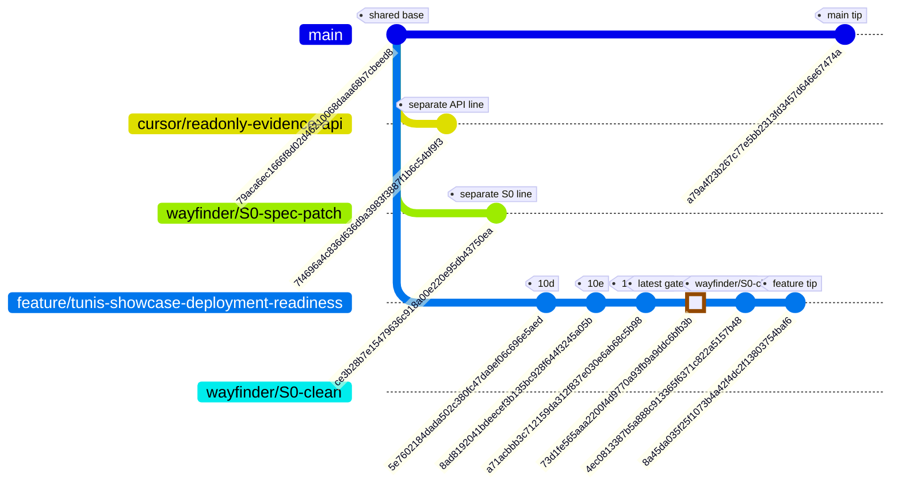
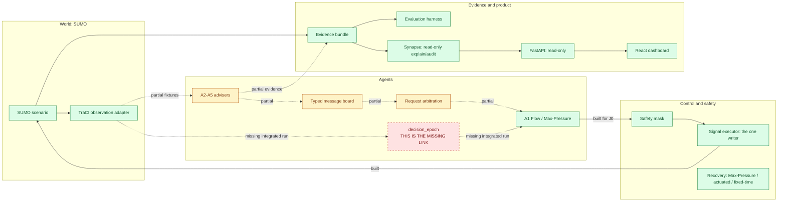

# CoFlow-5 Synapse project map

Reviewed branch: feature/tunis-showcase-deployment-readiness at 8a45da035f25f1073b4a42f4dc2f13803754baf6. Docs branch: docs/build-map. Facts use this branch's Git graph, queue, contracts, gates and source. A gate proves its declared contract only.

## Where am I?

Legend: normal = gated; HIGHLIGHT = latest gated row; REVERSE/TODO = planned; REVERSE/BLOCKED = blocked; optional = not needed for course completion.

**Two lines of history exist. The owner must choose the branch for new work.** Main and feature share 79aca6ec1666f8d02d46210068daaa68b7cbeed8. Commit 5e7602184dada502c380fc47da9ef06c696e5aed is on feature, not main. Task fallback selects feature. Cursor and wayfinder/S0-spec-patch are separate lines from base; wayfinder/S0-clean points inside feature. Origin refs mostly mirror local tips. README status prose is stale; use queue and gates.

## How the parts connect

**Only A1 writes signals. Synapse and the API only read.** The only raw signal write is src/coflow5/sumo_adapter/signal_executor.py. No decision_epoch was found coordinating A2-A5, board, A1 and safety in one SUMO run. Row 14 gates showcase data/provenance. scripts/build_tunis_sumo.py uses netconvert --tls.guess; six OSM candidates are POI markers, not the approved five signalized junctions plus J6 observer.

## Status and next action

| Row | Work | Status | Latest commit touching gate (full SHA) | Depends on | Next action |
|---|---|---|---|---|---|
| 01-smoke-test | Native SUMO smoke | unverified | missing/queue only | none | Queue says gated; gate missing |
| 02-evidence-bundle | Evidence bundle | gated | a6aa22933620e919771ab9add1a9064da88ad323 | 01-smoke-test | Follow contract |
| 03-safety-mask | Safety mask | gated | a6aa22933620e919771ab9add1a9064da88ad323 | 02-evidence-bundle | Follow contract |
| 04-baselines | Baselines | gated | a6aa22933620e919771ab9add1a9064da88ad323 | 03-safety-mask | Follow contract |
| 05-max-pressure | A1 Max-Pressure | gated | a6aa22933620e919771ab9add1a9064da88ad323 | 04-baselines | Follow contract |
| 06-message-board | Message board | gated | a6aa22933620e919771ab9add1a9064da88ad323 | 05-max-pressure | Follow contract |
| 07-a2-a3 | A2/A3 advisers | gated | 1f377e5c40af4f4aa0c82416effc8095e95d7047 | 06-message-board | Follow contract |
| 08-failure-injection | Failure injection | gated | 1f377e5c40af4f4aa0c82416effc8095e95d7047 | 07-a2-a3 | Follow contract |
| 09-eval-harness | Evaluation harness | gated | 1f377e5c40af4f4aa0c82416effc8095e95d7047 | 08-failure-injection | Follow contract |
| 10-a4-a5 | A4/A5 fixtures | gated | 1f377e5c40af4f4aa0c82416effc8095e95d7047 | 09-eval-harness | Follow contract |
| 10b-max-pressure-trip-kpis | Trip KPIs | gated | 1f377e5c40af4f4aa0c82416effc8095e95d7047 | 10-a4-a5 | Follow contract |
| 10c-evidence-page | Evidence page | gated | 1f377e5c40af4f4aa0c82416effc8095e95d7047 | 10b-max-pressure-trip-kpis | Follow contract |
| S0 | Persona/J0 honesty/incident schema | gated | 720efa0ec317bcb0a74341077a27f9ae24eb74d9 | none | Follow contract |
| D1 | Presentation aligned to repo | gated | 5e94b7f6b76ca5ab53df07c7538b0901766ed0cb | S0 | Follow contract |
| 10p | J0 pedestrian demand | gated | 8383df1dcb05dd5d0f3f32c2bb7723ee7c120db4 | D1 | Follow contract |
| 10d | Incident advisory contract | gated (contract only) | 5e7602184dada502c380fc47da9ef06c696e5aed | 10p | No proof all A2-A5 coordinate in one SUMO run |
| 10e | 5 seeds, 8 ablation cells | gated | 8ad8192041bdeecef3b135bc928f644f3245a05b | 10d | Evaluation does not prove runtime integration |
| 12 | Synapse | gated | a71acbbb3c712159da312f837e030e6ab68c5b98 | 10e | Follow contract |
| 11 | FastAPI | gated | a71acbbb3c712159da312f837e030e6ab68c5b98 | 12 | Follow contract |
| 13 | React dashboard | gated | a71acbbb3c712159da312f837e030e6ab68c5b98 | 11 | Follow contract |
| R | Release package | gated | a71acbbb3c712159da312f837e030e6ab68c5b98 | 13 | Follow contract |
| 14-tunis-showcase | OSM/GTFS data showcase | gated | 73d1fe565aaa2200f4d9770a93fb9a9ddc6bfb3b | R | Not controlled J1-J5 plus J6 observer |
| 15-optional-dqn | Optional DQN | optional | missing/queue only | 10e,12,11,13,R,14 | Queue status blocked until freeze |

The SHA is the latest commit touching each gate. Row 01 is unverified because queue says gated but its gate is missing. Row 10e has five seeds and eight ablation cells, but does not prove runtime integration. Row 14 is data/showcase only.

## How to connect everything

This follows harness/queue.tsv; the owner decides changes.

1. Ask the owner to approve a 10d-completion row for decision_epoch to run A2-A5, board, A1, safety and evidence in one SUMO run.
2. Use 10e seeds and ablations as gated evidence, not proof of the runtime seam.
3. Use the gated product chain: 12 explains evidence, 11 reads it, 13 displays it, R packages the walkthrough.
4. Build and verify the approved Tunis target: J1-J5 signalized, J6 observer. Row 14 gates data/provenance.
5. Reconcile Row 01's missing gate and verify release claims. Row 15 is optional and blocked.

## Junior glossary

| Term | Plain meaning | Data science comparison |
|---|---|---|
| SUMO / TraCI | Traffic simulator / Python control link | Synthetic data / API client |
| Seed / matched seeds | Fix random choices / same cases per controller | random_state / paired samples |
| Baseline / Max-Pressure | Simple controller / queue-pressure heuristic | Baseline / heuristic |
| Ablation | Turn adviser off and compare | Feature ablation |
| Bootstrap CI / Wilcoxon / Holm | Uncertainty, paired test, multiple-test correction | Statistical comparisons |
| Evidence bundle / manifest | Run files / inputs and hashes | Experiment run / metadata |
| Gate / contract | Pass check / promised scope | CI check / preregistered protocol |
| Safety mask | Reject unsafe signal changes | Hard output constraint |
| Adviser / Synapse | Suggests only / explains read-only | Feature provider / explainer |
| Unfinished trips | Cars that did not arrive | Censored data; keep it |
| Decision epoch | Ordered advice-to-action cycle | Pipeline step on frozen input |
| J0 / J1-J6 | One-junction test / planned six-junction target | Pilot / larger cohort |

## Claims and export

Say simulation evidence, not real-world result. Do not claim lives saved, measured air quality, or a best controller. Mark decision_epoch and Tunis 5+1 planned, not done. Row 10e gate has five matched seeds. Mermaid CLI mmdc is absent, so SVG export was skipped and no packages were installed. The HTML uses inline SVG/CSS and no external network.

## Agent roles, purpose, and tool boundaries

The repository contains five bounded adviser/controller modules (A1–A5), which exceeds the requested minimum of three. Their existence does not prove that all five coordinate in a single live SUMO run. Coordination is a typed-message design; the integrated decision epoch remains the key gap.

| Agent | Why it exists | Inputs and useful tools | Authority |
|---|---|---|---|
| A1 — Controller | Select a safe signal action from observed demand and adviser requests. | TraCI observations, Max-Pressure, typed board messages; `src/coflow5/control/a1_controller.py`, `max_pressure.py` | Proposes through the safety/executor boundary. It is the only intended path to signal writes. |
| A2 — Emergency | Represent emergency-vehicle priority as an expiring request with route, next junction, ETA, urgency, benefit, and civilian externality. | Typed request and message-board publish; `src/coflow5/a2/emergency.py` | Advisory only; cannot actuate. |
| A3 — Multimodal | Represent pedestrian clearance and conditional late-bus/transit priority. | Crossing/clearance state and transit request; `src/coflow5/a3/multimodal.py` | Advisory only; cannot actuate. |
| A4 — Situation | Classify incidents and forecast congestion with provenance, confidence, horizon, model version, and staleness. | Incident/situation records; `src/coflow5/a4/situation.py` | Advisory only; cannot actuate. |
| A5 — Sustainability | Estimate link-level emissions proxies and flag sensitive links or displaced impacts. | SUMO/HBEFA proxy inputs; `src/coflow5/a5/sustainability.py` | Advisory only; cannot actuate. |
| Shared message board | Coordinate agents through typed, inspectable messages. | `src/coflow5/messaging/board.py` | Carries requests; it is not a signal writer. |

These are bounded code modules and contracts, not evidence of five independently trained AI models. “Enough tools” means each role has access to the inputs and typed operations needed for its job, while only the safety-controlled executor writes signal states. Do not grant every agent direct TraCI or unrestricted tools.

## SWOT grounded in the inspected feature branch

- **Strengths:** one intended signal write boundary; typed adviser roles and message board; Row 10e has a passing declared gate with five matched seeds, eight ablation cells, and deterministic-repeat evidence; Synapse, API, dashboard, release, and Tunis showcase gates pass their declared contracts.
- **Weaknesses:** no integrated `decision_epoch` was found; all-agent single-run coordination is unproven; the Row 01 gate file is absent; the Tunis data showcase does not prove the approved five signalized junctions plus one observer junction; README status is stale.
- **Opportunities:** join the existing adviser, control, safety, and evidence paths in one reproducible run; use the professor-approved six-junction target; replay that run through the existing explanation and product chain.
- **Threats:** main and feature histories differ; moving Row 14 earlier would alter the queue dependency and needs owner approval; unclear learned-model requirement and deadline; simulation evidence could be overstated as real-world impact.

## Gaps and risks

| Area | Verified state | Remaining work | Priority |
|---|---|---|---|
| Coordination | Row 10d passes its declared incident-advisory contract. | Implement and demonstrate one ordered epoch across A2–A5, board, A1, safety, SUMO, and evidence. | High |
| Evaluation | Row 10e passes its declared five-seed/eight-cell contract, including deterministic repeat. | Evaluate the integrated runtime with predeclared matched runs and ablations; do not treat current gate as integration proof. | High |
| Tunis network | Row 14 passes the OSM/GTFS showcase/data contract (six candidate locations). | Build/register and verify J1–J5 signal control plus J6 observer; current `netconvert --tls.guess` does not establish that control registry. | High |
| Explainability | Row 12 and `SynapseService` (`explain`, `audit`, `metrics`, `event_summaries`) exist and pass their gate. | Replay final integrated evidence and verify explanations, citations, and abstention behavior on it. | Medium |
| Product | Rows 11, 13, and R pass their declared API, dashboard, and release contracts. | Validate the final integrated run through these existing surfaces; they are not skeleton TODOs. | Medium |
| Process | Feature contains the named milestones; main is a separate history and README is stale. | Owner chooses the durable source branch and reconciles narrative/status. | High |
| Queue Row 01 | Queue labels it gated; `harness/work/01-smoke-test/gate.json` is absent. | Resolve the mismatch; current evidence is unverified, not a proven environment block. | High |

Risk controls: keep the executor as the sole signal write site; preserve run IDs, input hashes, action hashes, and provenance end to end; fail closed on stale or malformed requests; do not claim learned intelligence unless an actual model and its evaluation are in scope; label the Tunis result as simulation/showcase evidence.

## Owner decisions still needed

1. Are learned models required, or are bounded rule-based/statistical advisers acceptable? What is the delivery deadline?
2. Approve a `decision_epoch` completion contract for Row 10d, or keep integration as a separately named queue item?
3. Should the queue be reordered to deliver the Tunis network before Row R? Row 14 currently depends on R; any change requires owner approval.
4. Which contiguous Tunis corridor/bounding box and signal phases should define J1–J5, and what qualifies J6 as observer-only?
5. Which branch should be the long-term source of truth? Six junctions (J1–J5 control, J6 observer) is already professor-approved.

## Proposed 62-day completion plan (estimate, not queue status)

The current queue remains authoritative. This is a planning proposal with dependencies, review points, and estimates; it does not silently reorder queue rows or declare gated work unfinished. Tasks involving Rows 10e, 12, 11, 13, R, and 14 are follow-up integration/verification on final evidence, not rebuilds of passing deliverables.

| ID | Estimate | Deliverable |
|---|---:|---|
| P01 | Day 1 | Record the branch/source-of-truth decision; this build map already records current facts. |
| P02 | Days 1–3 | Resolve learned-model requirement and deadline; six-junction target is already approved. |
| P03 | Days 2–4 | Reconcile README narrative with queue/gate facts. |
| P04 | Days 4–6 | Review and accept this evidence map. |
| P05 | Days 7–8 | Approve or defer the Row 10d integrated-epoch completion contract. |
| P06 | Days 8–9 | Freeze evidence keys and junction identities. |
| P07 | Days 9–11 | Connect A2–A5 to the shared typed board in the integrated runner. |
| P08 | Days 12–13 | Make A1 consume bounded requests and emit reason codes. |
| P09 | Days 14–15 | Produce one run-ID trace from observation through requests, decision, action, trips, and evidence. |
| P10 | Days 16–17 | Verify safety, Synapse isolation, and repeat hashes on the integrated run. |
| P11 | Days 18–20 | Predeclare integrated evaluation conditions and metrics. |
| P12 | Days 21–23 | Run at least five matched integrated scenarios for cooperative, actuated, and fixed-time controllers. |
| P13 | Days 24–26 | Run integrated adviser on/off ablations. |
| P14 | Days 27–28 | Define the Tunis junction registry schema. |
| P15 | Days 29–31 | Select and document the contiguous corridor and junction classification. |
| P16 | Days 32–34 | Build and run five controlled signal junctions plus J6 observer. |
| P17 | Day 35 | Verify exactly five controlled writers and zero writes at J6. |
| P18 | Days 36–38 | Replay final evidence through existing Synapse. |
| P19 | Days 39–41 | Check explanation questions, citations, and abstentions on final evidence. |
| P20 | Days 42–44 | Verify Synapse cannot start SUMO or use TraCI to change signals. |
| P21 | Days 45–46 | Run a Synapse kill test and confirm action hashes do not change. |
| P22 | Days 47–49 | Verify API provenance and abstentions for the final run. |
| P23 | Days 50–52 | Verify dashboard views against a frozen final run. |
| P24 | Days 53–55 | Verify remaining dashboard views and raw evidence links. |
| P25 | Days 56–57 | Check claim labels and no-control guarantees. |
| P26 | Days 58–60 | Check offline release hashes, secrets, and local-path leakage. |
| P27 | Days 61–62 | Rehearse the demo and present limitations with evidence. |

Re-estimate after owner decisions and integration findings; these day ranges are planning estimates, not a commitment or proof of completion.
