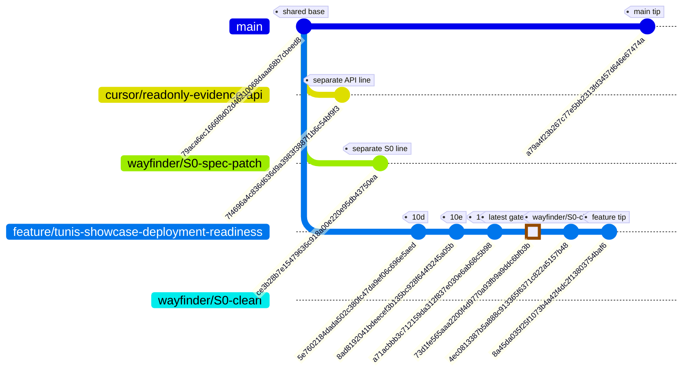
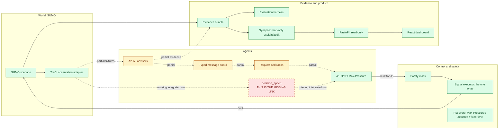

# CoFlow-5 Synapse project map

Reviewed branch: feature/tunis-showcase-deployment-readiness at 8a45da035f25f1073b4a42f4dc2f13803754baf6. Docs branch: docs/build-map. Facts use this branch's Git graph, queue, contracts, gates and source. A gate proves its declared contract only.

## Where am I?

Legend: normal = gated; HIGHLIGHT = latest gated row; REVERSE/TODO = planned; REVERSE/BLOCKED = blocked; optional = not needed for course completion.

**Two lines of history exist. The owner must choose the branch for new work.** Main and feature share 79aca6ec1666f8d02d46210068daaa68b7cbeed8. Commit 5e7602184dada502c380fc47da9ef06c696e5aed is on feature, not main. Task fallback selects feature. Cursor and wayfinder/S0-spec-patch are separate lines from base; wayfinder/S0-clean points inside feature. Origin refs mostly mirror local tips. README status prose is stale; use queue and gates.

## How the parts connect

**Only A1 writes signals. Synapse and the API only read.** The only raw signal write is src/coflow5/sumo_adapter/signal_executor.py. No decision_epoch was found coordinating A2-A5, board, A1 and safety in one SUMO run. Row 14 gates showcase data/provenance. scripts/build_tunis_sumo.py uses netconvert --tls.guess; six OSM candidates are POI markers, not the approved five signalized junctions plus J6 observer.

## Status and next action

| Row | Work | Status | Latest commit touching gate (full SHA) | Depends on | Next action |
|---|---|---|---|---|---|
| 01-smoke-test | Native SUMO smoke | unverified | missing/queue only | none | Queue says gated; gate missing |
| 02-evidence-bundle | Evidence bundle | gated | a6aa22933620e919771ab9add1a9064da88ad323 | 01-smoke-test | Follow contract |
| 03-safety-mask | Safety mask | gated | a6aa22933620e919771ab9add1a9064da88ad323 | 02-evidence-bundle | Follow contract |
| 04-baselines | Baselines | gated | a6aa22933620e919771ab9add1a9064da88ad323 | 03-safety-mask | Follow contract |
| 05-max-pressure | A1 Max-Pressure | gated | a6aa22933620e919771ab9add1a9064da88ad323 | 04-baselines | Follow contract |
| 06-message-board | Message board | gated | a6aa22933620e919771ab9add1a9064da88ad323 | 05-max-pressure | Follow contract |
| 07-a2-a3 | A2/A3 advisers | gated | 1f377e5c40af4f4aa0c82416effc8095e95d7047 | 06-message-board | Follow contract |
| 08-failure-injection | Failure injection | gated | 1f377e5c40af4f4aa0c82416effc8095e95d7047 | 07-a2-a3 | Follow contract |
| 09-eval-harness | Evaluation harness | gated | 1f377e5c40af4f4aa0c82416effc8095e95d7047 | 08-failure-injection | Follow contract |
| 10-a4-a5 | A4/A5 fixtures | gated | 1f377e5c40af4f4aa0c82416effc8095e95d7047 | 09-eval-harness | Follow contract |
| 10b-max-pressure-trip-kpis | Trip KPIs | gated | 1f377e5c40af4f4aa0c82416effc8095e95d7047 | 10-a4-a5 | Follow contract |
| 10c-evidence-page | Evidence page | gated | 1f377e5c40af4f4aa0c82416effc8095e95d7047 | 10b-max-pressure-trip-kpis | Follow contract |
| S0 | Persona/J0 honesty/incident schema | gated | 720efa0ec317bcb0a74341077a27f9ae24eb74d9 | none | Follow contract |
| D1 | Presentation aligned to repo | gated | 5e94b7f6b76ca5ab53df07c7538b0901766ed0cb | S0 | Follow contract |
| 10p | J0 pedestrian demand | gated | 8383df1dcb05dd5d0f3f32c2bb7723ee7c120db4 | D1 | Follow contract |
| 10d | Incident advisory contract | gated (contract only) | 5e7602184dada502c380fc47da9ef06c696e5aed | 10p | No proof all A2-A5 coordinate in one SUMO run |
| 10e | 5 seeds, 8 ablation cells | gated | 8ad8192041bdeecef3b135bc928f644f3245a05b | 10d | Evaluation does not prove runtime integration |
| 12 | Synapse | gated | a71acbbb3c712159da312f837e030e6ab68c5b98 | 10e | Follow contract |
| 11 | FastAPI | gated | a71acbbb3c712159da312f837e030e6ab68c5b98 | 12 | Follow contract |
| 13 | React dashboard | gated | a71acbbb3c712159da312f837e030e6ab68c5b98 | 11 | Follow contract |
| R | Release package | gated | a71acbbb3c712159da312f837e030e6ab68c5b98 | 13 | Follow contract |
| 14-tunis-showcase | OSM/GTFS data showcase | gated | 73d1fe565aaa2200f4d9770a93fb9a9ddc6bfb3b | R | Not controlled J1-J5 plus J6 observer |
| 15-optional-dqn | Optional DQN | optional | missing/queue only | 10e,12,11,13,R,14 | Queue status blocked until freeze |

The SHA is the latest commit touching each gate. Row 01 is unverified because queue says gated but its gate is missing. Row 10e has five seeds and eight ablation cells, but does not prove runtime integration. Row 14 is data/showcase only.

## How to connect everything

This follows harness/queue.tsv; the owner decides changes.

1. Ask the owner to approve a 10d-completion row for decision_epoch to run A2-A5, board, A1, safety and evidence in one SUMO run.
2. Use 10e seeds and ablations as gated evidence, not proof of the runtime seam.
3. Use the gated product chain: 12 explains evidence, 11 reads it, 13 displays it, R packages the walkthrough.
4. Build and verify the approved Tunis target: J1-J5 signalized, J6 observer. Row 14 gates data/provenance.
5. Reconcile Row 01's missing gate and verify release claims. Row 15 is optional and blocked.

## Junior glossary

| Term | Plain meaning | Data science comparison |
|---|---|---|
| SUMO / TraCI | Traffic simulator / Python control link | Synthetic data / API client |
| Seed / matched seeds | Fix random choices / same cases per controller | random_state / paired samples |
| Baseline / Max-Pressure | Simple controller / queue-pressure heuristic | Baseline / heuristic |
| Ablation | Turn adviser off and compare | Feature ablation |
| Bootstrap CI / Wilcoxon / Holm | Uncertainty, paired test, multiple-test correction | Statistical comparisons |
| Evidence bundle / manifest | Run files / inputs and hashes | Experiment run / metadata |
| Gate / contract | Pass check / promised scope | CI check / preregistered protocol |
| Safety mask | Reject unsafe signal changes | Hard output constraint |
| Adviser / Synapse | Suggests only / explains read-only | Feature provider / explainer |
| Unfinished trips | Cars that did not arrive | Censored data; keep it |
| Decision epoch | Ordered advice-to-action cycle | Pipeline step on frozen input |
| J0 / J1-J6 | One-junction test / planned six-junction target | Pilot / larger cohort |

## Claims and export

Say simulation evidence, not real-world result. Do not claim lives saved, measured air quality, or a best controller. Mark decision_epoch and Tunis 5+1 planned, not done. Row 10e gate has five matched seeds. Mermaid CLI mmdc is absent, so SVG export was skipped and no packages were installed. The HTML uses inline SVG/CSS and no external network.
