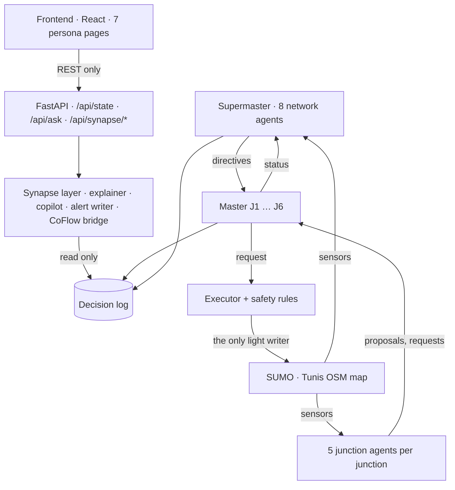
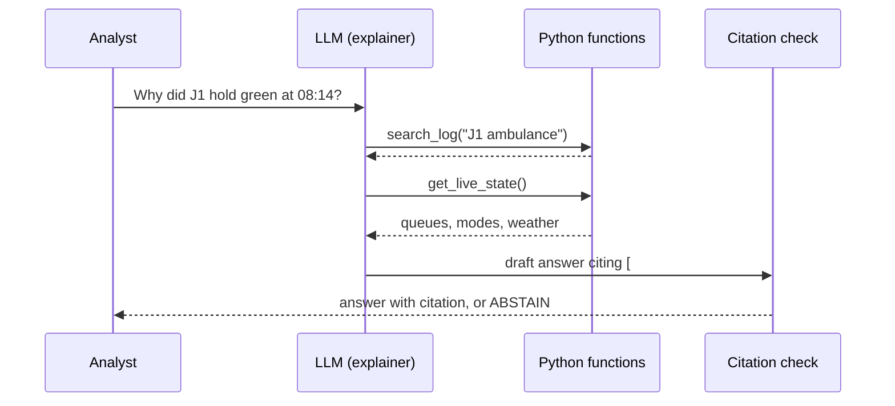
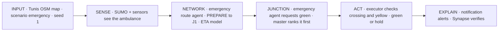

# TraffiX · CoFlow-5 Synapse — Prototype Validation

Advanced Data Science Project · Esprit 2627-5DS1 · Team Hi Five +1

This document follows the six sections of the validation brief.
Every claim points to code or a file in this repository.

| Section | Speaker | Time |
|---|---|---|
| 1. Problem and objectives | Member 1 | 2 min |
| 2a. Architecture, junction agents, information flow | Member 2 | 3 min |
| 2b. Network agents, Synapse agents, LLM tools | Member 3 | 3 min |
| 3. Prototype demonstration (live) | Member 4 | 4 min |
| 4. Data science and technical approach | Member 5 | 3 min |
| 5–6. Validation, limits, next steps | Member 6 | 3 min |

Every member must be able to answer for every agent: role, objective, model, tools. The tables in section 2 give these answers.

---

## 1. Problem and targeted objectives

### 1.1 Problem

- The lights in Tunis centre-ville run fixed or actuated plans.
- Each light sees only its own queue. It does not see the road after the junction.
- An ambulance reaches a red light because the junction sees it too late.
- Late buses bunch together. Priority for every bus hurts all other users.
- Green can start while a pedestrian is still on the crossing.
- No one can say why a light changed.

### 1.2 Target users

Seven personas. Each has one page in the web app.

| Persona | Need |
|---|---|
| Pedestrian · Ferjani | short wait, safe crossing |
| Car driver · Faycel | trip planner, alerts, alternative route |
| Bus passenger · Mamadou | next buses at the stop |
| Bus driver · Hédi | schedule gap, bus priority |
| Ambulance crew · Touhami | green ahead, free exits |
| Operator · Kamel | alerts, data health, control modes |
| Analyst · Tahani | the reason for each decision |

### 1.3 Main objective

Reduce waiting time at six real junctions of Tunis centre-ville (J1–J6) with cooperating AI agents, and keep safety, fairness and explanations.

### 1.4 Specific objectives

| # | Specific objective | Measure | Target |
|---|---|---|---|
| O1 | Reduce car waiting time | mean car wait vs SUMO actuated | lower |
| O2 | Give green ahead to emergency vehicles | emergency trip time | lower |
| O3 | Protect pedestrians | green started during a crossing | 0 |
| O4 | Help late buses only | bus lateness; car wait not worse | lower |
| O5 | Explain every decision | decisions with a reason code | 100% |
| O6 | Use a model only if it helps | model error vs its rule | lower |
| O7 | One safe writer per light | architecture check | passes in CI |

### 1.5 How the solution answers the problem

| Problem | Answer |
|---|---|
| A light sees one queue | Max-pressure light agent compares the queue in and the room out. The supermaster sees the whole network. |
| Ambulance sees red | Emergency route agent warns the junctions ahead. The master gives emergency the highest priority after safety. |
| Bus bunching | Transit monitor finds late buses. Only late buses get priority. |
| Pedestrian safety | The executor applies fixed safety rules before every change: minimum green, yellow, pedestrian clearance. |
| No explanation | Every decision goes to a decision log with a reason code. Synapse explains it or abstains. |

---

## 2. Multi-agent architecture

### 2.1 Overall architecture



Four levels:
1. **Junction level** — at each of J1–J6: one master and five agents.
2. **Network level** — one supermaster runs eight network agents.
3. **Synapse level** — four agents that read the log and explain. They never write a light.
4. **Interface** — FastAPI and seven React pages.

Rules (enforced by `scripts/check_architecture.py`, run in CI):
- Only `traffix/simulation/executor.py` writes a light. Only masters call it.
- Agents read sensors. They never call SUMO.
- Synapse cannot import SUMO, the executor or a master.
- Agents never see the scenario events or the calendar assumptions.

### 2.2 Design patterns

| Pattern | Where | Why |
|---|---|---|
| Hierarchical supervisor | supermaster → masters | wide view for network problems; local decisions stay fast |
| Single writer | master + executor | one light, one decider, no conflicting commands |
| Propose → arbitrate | `master.py` | agents only ask; a fixed priority order decides |
| Publish / subscribe bus | `core/messages.py` | agents share events without direct calls |
| Rule + model hybrid | every learned agent | a model is used only if it beats its rule; the rule is the fallback |
| Graceful degradation | master modes | max-pressure → actuated → fixed when data is stale |
| Tool-using LLM agent | explainer | the LLM picks a tool; Python runs it; answers cite log ids |
| Verify or abstain | Synapse | a false citation or a changed number is rejected |
| Human in the loop | operator copilot | "approve" is recorded, never applied automatically |

### 2.3 Junction agents (one set at each of J1–J6)

| Agent | Targeted objective | Responsibilities | Model and justification | Tools |
|---|---|---|---|---|
| **Master** | one decider per light | collects proposals every second, applies the priority order, asks the executor | none: fixed priority + safety rules. Safety must not change with data. | `executor.request()`, message bus, `log()` |
| **Traffic light** | move the longest queue if the next road has room | proposes the next phase | max-pressure (default, proven, explainable); options: predictive MPC with the arrivals model, RL (Fitted Q-Iteration) | lane queues in and out, `propose()` |
| **Pedestrian** | no long wait; no green during a crossing | requests a walk phase | gradient-boosting classifier: will this person wait too long? Beats the threshold rule. | people waiting, wait times, `request()` |
| **Transit priority** | help late buses only | requests priority for a late bus | gradient-boosting regressor: bus ETA to the stop line | approaching buses, lateness, `request()` |
| **Emergency priority** | green before the ambulance arrives | requests green with the predicted arrival time | gradient-boosting regressor: ambulance ETA. Rule fallback: distance ÷ speed. | emergency vehicles (type, distance, speed), `request()` |
| **Sensor health** | stale data must not drive a light | publishes DATA_STALE; the master falls back | rule (no update for 10 s → stale). A trained classifier lost to the rule (F1 0.75 vs 0.98), so the model file was deleted and the rule is used | detector age, `publish()` |

Priority order in every master: **safety > emergency > supermaster directive > late bus > pedestrian > normal**.

### 2.4 Network agents (run by the supermaster)

Cadence: every 5 s. Incident detection, transit monitor and emergency route: every 1 s.

| Agent | Targeted objective | Model and justification | Tools / output |
|---|---|---|---|
| **Demand forecast** | traffic level for the next hour | 2 gradient-boosting regressors; learns calendar effects (Ramadan moves 11 days a year) | calendar features, counts → forecast |
| **Incident detection** | find blocked lanes and congestion | gradient-boosting classifier on speed and occupancy patterns | edge sensors → publish INCIDENT |
| **Rerouting** | alternative route for drivers | travel-time regressor + shortest path | network graph, travel times → advice only |
| **Emergency route** | warn junctions ahead of an emergency vehicle | arrival-time regressor | vehicle route → directive PREPARE |
| **Corridor** | green waves between neighbours | tuned platoon weight (parameter search) | neighbour queues → directive BIAS |
| **Transit monitor** | find late buses | lateness regressor | bus positions, lines → publish LATE |
| **Weather** | longer timings in rain; flood response | rain-effect regressor | weather state → directive + FLOOD |
| **Notification** | right alert to the right page | decision tree trained on our own rules | publications → notifications for 7 pages |

### 2.5 Synapse agents (read only)

| Agent | Targeted objective | Model and justification | Tools |
|---|---|---|---|
| **Explainer** | answer "why?" with proof | LLM: Claude Sonnet, or Groq `openai/gpt-oss-120b`. Free questions need language. Tool calls keep the answer grounded. | `search_log(query)`, `get_live_state()`, `get_results(measure)`; max 5 tool rounds; Python citation check, otherwise ABSTAIN |
| **Operator copilot** | summary and suggested actions for the operator | LLM: Claude Sonnet, or Groq `openai/gpt-oss-120b`. Must reason over many alerts at once. | `context()`, `summary()`, `report()`, `decide()` (only records approve/reject) |
| **Alert writer** | alerts in English, French and Arabic | LLM: Claude Haiku, or Groq `openai/gpt-oss-20b`. Short, frequent text: fast and cheap. | templates (`i18n.py`); a rewrite that changes a number is rejected |
| **CoFlow Synapse bridge** | verify a decision or a claim | no LLM. A verification must give the same answer every time. | reason-code table, decision log, CoFlow `SynapseService` → verified / template / abstain + 7 provenance fields |

No API key, or the API fails → templates. The control loop never waits for an LLM.
Configuration: `config/agents.yaml` (provider `auto | anthropic | groq`). Key in a local `.env`.

### 2.6 The LLM agent with tools



- A **tool** is the description the LLM reads. A **function** is the Python code that runs.
- No tool writes a light, calls SUMO or opens the web.

### 2.7 Information flow (one simulated second)

1. SUMO moves every vehicle and person one step.
2. The world adds scenario events (rain, incident, sensor fault). Agents do not see them.
3. Sensors read queues, speeds, people and vehicles.
4. Every 5 s the supermaster sends directives (PREPARE, BIAS, weather).
5. Junction agents send proposals and requests to their master.
6. Each master applies the priority order and decides.
7. The executor checks the safety rules and writes the light.
8. The decision log stores the decision with its reason code. The API publishes a snapshot.

Message bus: 6 message kinds — request, proposal, directive, status, publication, notification. Every message has an expiry time.

How each part supports the main objective:
- Junction agents → local efficiency (O1, O3, O4).
- Network agents → what one junction cannot see: ambulances ahead, incidents, rain, late lines (O1, O2, O4).
- Master + executor → safety and one writer (O3, O7).
- Synapse → explanations (O5).

---

## 3. Prototype demonstration

### 3.1 Main functions (implemented)

- Live simulation on the real Tunis map, J1–J6, controlled by the agent hierarchy.
- 12 scenarios: off-peak, morning peak, evening peak, heavy, incident, emergency, rain, bus disruption, rush transition, Ramadan pre-iftar, pre-Eid shopping, combined.
- 7 persona pages on one live run. Esri basemap aligned to the network. Real-size vehicles. 25 TRANSTU line directions.
- Trip planner with alternative routes.
- Operator copilot with summary and approve/reject (recorded only).
- Analyst page: decision log, "Ask why", and **Verify with CoFlow Synapse**.
- Alerts, copilot and answers in English, French or Arabic (language select in the top bar).
- Experiment runner: 7 controllers × 12 scenarios × seeds; analysis with charts and paired t-tests.

### 3.2 Use case: an ambulance crosses J1

**User:** Tahani, analyst. **Also served:** Touhami (ambulance crew), Faycel (driver).



| Step | Agent | What it does | Log entry |
|---|---|---|---|
| 1 | Emergency route (network) | sees the whole route; sends J1 a PREPARE directive about 38 s before arrival | `#336 EMERGENCY_PREPARE` |
| 2 | Emergency priority (J1) | requests green with the ETA its model predicts | request |
| 3 | Master J1 | emergency outranks all except safety; checks the exit is free | decision |
| 4 | Executor | clears the crossing, yellow, then green. Here the light is already green, so it holds. | `#337 EMERGENCY_GRANTED_HOLD` |
| 5 | Master J1 | the request expires; normal control resumes | `#341 RECOVERY_STARTED` |
| 6 | Notification + Synapse | crew and drivers get alerts; the analyst verifies the decision | verified, citation #337, 7 hashes |

Output:
- **For users:** green ahead for the ambulance; an alert on the driver page; a verified reason on the analyst page.
- **Measured:** emergency trip time and mean car wait (section 5).

### 3.3 Demo script

```powershell
py -3.11 scripts\run_live.py      # http://localhost:8000 (add --gui to also open sumo-gui)
```

Full scene plan with timings: [`demo-video-guide.md`](demo-video-guide.md).

1. Select scenario **emergency** and **16× speed**. Press **Start**. The first emergency vehicle appears at about 21:45 sim time (about 90 s).
2. Operator page: show the live map, the six masters, the copilot summary.
3. Wait for an ambulance near J1. Point at the light change on the map (or in sumo-gui).
4. Analyst page: find the `EMERGENCY_GRANTED` decision. Click **Verify with CoFlow Synapse**. Show the citation and the provenance hashes.
5. Ask: "Why did ambulance get green at J1?" Show the cited answer.
6. Audit a false claim (for example a wrong junction). Show **abstain**.

Backup if the network fails: no API key is needed. The explainer and alerts fall back to templates.

---

## 4. Data science and technical approach

### 4.1 Data used

| Data | Source | Size | Use |
|---|---|---|---|
| Road network | OpenStreetMap, Tunis centre-ville, data as of 2026-10-15 | 1,335 edges; 6 signalised junctions | SUMO network |
| Junction choice | fixed rule over the OSM graph (`selection.json`) | 6 nodes | J1–J6 |
| Lane evidence | OSM tags + desk imagery search (`lane_overrides.json`) | 21 junction roads; 3 tagged | network build |
| Traffic demand | synthetic, `randomTrips`, fixed seeds 20261016 / 20261017 | 2,400 vehicles/h base + pedestrians | every run |
| Bus lines | TRANSTU-attributed community data | 13 lines, 25 directions, 16 stops | transit agents |
| Calendar | `hijridate` + sunset formula | Ramadan, Eid, iftar, peaks | demand pattern; hidden from agents |
| Scenarios | `config/scenarios.yaml` | 12 | training on 2025 dates, tests on 2026 |
| Training rows | simulation recorder | ~360,000 rows in 9 tables | supervised learning |

Why synthetic demand: no open traffic counts exist for these junctions. Synthetic demand lets us control and repeat each event. A seed fixes the random numbers, so the same seed gives the same traffic.

Why the labels are valid: the recorder writes what an agent saw at time t, and later what really happened. This gives labelled data without manual work. Agents never read the scenario events.

### 4.2 Main technical choices

| Choice | Reason |
|---|---|
| SUMO 1.27 + TraCI / libsumo | standard open-source traffic simulator; real lights, people, buses |
| OSM + netconvert | real streets of Tunis; reproducible build from a committed extract |
| Python, scikit-learn | small tabular data; fast on a laptop CPU |
| FastAPI + React | the UI never touches the simulator; one read-only API |
| YAML configuration | every assumption is visible and changeable |
| Optional LLM (Anthropic or Groq) | language only; deterministic fallback |

### 4.3 ML and AI components

| Component | Type | Agent | Contribution |
|---|---|---|---|
| Demand forecast | 2 × HistGradientBoosting regressors | demand forecast | anticipates peaks and Ramadan (O1) |
| Pedestrian | HistGradientBoosting classifier | pedestrian | serves long waits first (O3) |
| Ambulance ETA | regressor | emergency priority, emergency route | green on time (O2) |
| Bus ETA, bus lateness | regressors | transit priority, transit monitor | priority for late buses only (O4) |
| Rain speed | regressor | weather | timings for rain (O1) |
| Arrivals | regressor | predictive light | look-ahead control (O1) |
| Edge travel time | regressor | rerouting | alternative routes (O1) |
| Incident | classifier | incident detection | early incident response (O1) |
| Notification | decision tree | notification | right alert to the right page |
| Max-pressure | control algorithm | traffic light (default) | stable, proven, explainable (O1) |
| Fitted Q-Iteration | reinforcement learning | traffic light (option) | learns from experience; neighbours in the reward |
| LLMs | Claude / Groq | explainer, copilot, alert writer | explanations and alerts (O5) |
| CoFlow SynapseService | deterministic verifier | CoFlow bridge | verified / abstain with provenance (O5) |

Why gradient-boosted trees: the data is small tables of numbers; they learn thresholds (queue length, minutes to sunset); they train in seconds on a CPU; they are easy to compare with a rule.

Why not deep learning: little data, a one-second control loop, and every decision must be explained.

### 4.4 Training method

1. **Generate** — 20 runs on the Tunis map with 2025 dates.
2. **Fit** — each model on 75% of the rows; test on 25% against its rule.
3. **Tune** — light parameters by random search on simulation (score = mean car wait + pedestrian wait).
4. **RL** — 3 rounds of Fitted Q-Iteration: gamma 0.9, 12 refits, reward = own wait + 0.5 × neighbours' mean queue, 60 s starvation guard.
5. **Test** — 12 scenarios with 2026 dates × controllers × seeds.

Latest full training (commit `e141c7b`, Tunis map, Python 3.11.9, scikit-learn 1.9.1):
- About 850,000 rows from 20 runs (10 training scenarios × 2 seeds).
- **Tuning:** 8 random trials per light agent. None beat the default settings (max-pressure score 132.74; predictive 149.51), so the defaults stay.
- **RL:** car + pedestrian wait 232.6 s → 217.2 s → 208.9 s over the 3 rounds (with exploration). In the fair final test (no exploration) RL waits **231.4 s** and max-pressure **221.9 s**. RL is about 4% worse, so **max-pressure stays the default**; RL stays an option (`traffix_rl`).

LLMs: we call hosted models through an API (Claude, or `openai/gpt-oss-120b` / `gpt-oss-20b` on Groq). We do not train them. We use no embedding model: `search_log` uses keyword matching over the fixed reason codes, and every citation is checked. An open-weights model (for example Mistral 7B) with embedding search was in an early plan and was not built.

Train on 2025, test on 2026: Ramadan moves by 11 days a year, so a model that memorised dates fails.

Command: `py -3.11 scripts\train.py` (30–60 min).

---

## 5. Validation and feedback

### 5.1 Tests performed

| Test | What it checks | Result |
|---|---|---|
| Automated tests (`tests/traffix`, `tests/scripts`, `tests/api`, `tests/architecture`, `tests/properties`, Synapse contract) | agents, Tunis network, TRANSTU lines, lanes, basemap, Synapse API, safety properties, incident places visible to the agent | 115 pass |
| Integration test on the real map | 6 masters, named lights, places, bus lines, bridge verify/abstain, a real 300 s SUMO run | pass |
| Architecture check (`scripts/check_architecture.py`, in CI) | one light writer; Synapse cannot reach SUMO; agents do not see the calendar | pass |
| Model vs rule | each model against its rule on held-out data | see 5.2 |
| Controller comparison (`run_experiments.py`) | fixed, actuated, traffix (rules), traffix (models); 3 scenarios × 3 seeds | see 5.3 |
| Live stress test | all 12 scenarios run to the end in the web app; every page's API polled twice a second | 0 app errors; first time of every alert recorded ([`demo-video-guide.md`](demo-video-guide.md)) |

### 5.2 Models against their rules

Error: lower is better. F1: higher is better.

| Model | Model vs rule | Status |
|---|---|---|
| demand forecast (tested on 2026) | 0.023 vs 0.044 (Ramadan 0.026 vs 0.103) | used |
| pedestrian | F1 0.443 vs 0.0 (precision 0.40, recall 0.50) | used, still weak |
| ambulance ETA | 43.7 s vs 92.6 s (737 rows) | used |
| bus ETA | 139.7 s vs 285.8 s | used |
| bus lateness | 158.9 s vs 212.3 s (270 rows) | used, few data |
| edge travel time | 0.53 vs 2.5 | used |
| rain speed | 0.15 vs 0.38 | used |
| arrivals | 0.69 vs 0.69 | no gain |
| sensor health | F1 0.752 vs 0.978 | rule wins; model deleted, rule used |
| incident | skipped: no labelled incidents (the training places had no detector; fixed, needs a retrain) | old model deleted; rule used (detects in ~50 s, 0 false alarms) |
| notification | training accuracy 1.0 | copies our own rules; proves nothing |

Source: `models/metrics.json`. 7 of 11 models beat their rule.

### 5.3 Controller results (Tunis map, 3 seeds)

Mean of seeds 1–3, current network and models (20 Oct 2026). Source: `results/results.csv`,
`results/summary_by_persona.csv`, `results/significance.csv`. Lower is better. Best in **bold**.

| Scenario | Measure | SUMO fixed | SUMO actuated | traffix rules | traffix models |
|---|---|---|---|---|---|
| morning peak | mean car wait | 122.6 s | 118.5 s | **101.8 s** | 105.9 s (−11% vs actuated) |
| emergency | mean car wait | **62.2 s** | 65.9 s | 68.7 s | 78.8 s (+20%) |
| incident | mean car wait | **69.1 s** | 96.1 s | 98.1 s | 73.5 s (−24%) |
| morning peak | mean pedestrian wait | 140.2 s | 144.1 s | 128.1 s | **116.3 s** (−19%) |
| emergency | mean pedestrian wait | 139.1 s | 152.2 s | 107.6 s | **98.3 s** (−35%) |
| incident | mean pedestrian wait | 123.9 s | **111.1 s** | 118.9 s | 123.3 s (+11%) |
| emergency | emergency vehicle trip | **197.0 s** | 213.2 s | 232.3 s | 240.0 s (+13%) |
| all three | car green started while people were crossing (per run) | 239–281 | 331–405 | 16–19 | **17–19** (−95%) |
| incident | lane blockage detected / delay / false alarms | — | — | 3 of 3 / 50 s / 0 | 3 of 3 / 51 s / 0 |

Paired t-tests (traffix vs actuated, and models vs rules): none is significant at p < 0.05 with 3 seeds.
The closest: pedestrian wait, morning peak, models vs rules −9% (p = 0.06).

### 5.4 Results against objectives

| # | Result | Status |
|---|---|---|
| O1 | car wait vs actuated: −11% morning, −24% incident, +20% emergency; not significant | partial |
| O2 | emergency trip 240 s vs 213 s actuated and 197 s fixed: slower | not met |
| O3 | car greens started during a crossing: about 18 per run vs 331–405 with actuated (−95%), not 0 | partial |
| O4 | lateness model better than its rule; bus KPI per line not yet measured | partial |
| O5 | every decision has a reason code; a false claim gives abstain | met |
| O6 | 7 of 11 models beat their rule | partial |
| O7 | architecture check passes in CI | met |

### 5.5 Limitations

- **Synthetic demand.** These are simulation results, not Tunis measurements.
- **Three seeds, three scenarios.** No difference is significant yet. Earlier one-seed numbers (−41% car wait, ambulance 487 → 241 s) were measured before the lane, speed and bus-line changes and are replaced by 5.3.
- **Ambulances are slower with traffix** (240 s vs 213 s actuated). Not yet explained: the preparation horizon, the extra car wait in this scenario, or the routes may be the cause.
- **Heavy scenario:** near saturation (after about 53 min, ~466 vehicles) the web app can freeze for up to 19 s.
- **Lanes.** 18 of 21 junction roads have unverified lane counts (SUMO defaults).
- **Bus data.** Community data, not an official feed. Headways (15 min) are assumed.
- **Calendar factors** are our assumptions.
- **Weak models.** Arrivals equals its rule. Pedestrian F1 is only 0.44. Bus lateness has 270 rows. Sensor health loses to its rule (model deleted). Incident has no model (no labelled incidents until the place fix); both agents use their rules.
- **RL** is 4% worse than max-pressure; tuning found nothing better than the defaults.
- **No embeddings / local LLM.** Retrieval is keyword-based; LLMs are hosted.

### 5.6 Difficulties encountered

| Difficulty | Solution |
|---|---|
| The 6 OSM junctions had no signals | `netconvert --tls.set`; OSM signal tags removed |
| Clip by "any node inside" gave a 1.8 × 3.4 km network | ways cut at the box edge |
| J1 roundabout has short approaches (< 40 m) | stop threshold set to 20 m |
| traffix expects light id = node id | both renamed to J1–J6 by a plain-XML round trip |
| The real grid jammed at 4,000 veh/h | network override of 2,400 veh/h |
| A teleported bus crashed the monitor | arrived buses removed first |
| The audit accepted a false claim | facts limited to time, action, reason code, agent |
| Ramp guessing added false lanes; 80–100 km/h on city roads | ramp guessing off; 50 km/h legal urban limit |
| An unsupported claim that lanes matched imagery | removed; lanes tracked with evidence status |
| Parallel experiment runs hung | `--workers 1` |
| The live app ran at 4× instead of 16×: pandas loaded pyarrow's `arrow.dll` before SUMO's | pandas imported only where results are read (live run about 23×) |
| Every incident place was a road without a detector, so no incident was ever detected (and none could be labelled for training) | places moved to junction approaches; a test keeps them visible |
| Synapse abstained on "Why did J1 switch?" | a junction match is enough to select log entries |
| Alerts showed SUMO ids ("Heavy traffic on 1501192411#3") and an ETA of −24 s | street names in alerts, copilot and trips; ETA clamped at 0 |
| French and Arabic alerts existed but no control showed them | language select in the top bar |

---

## 6. Next steps

### 6.1 Remaining tasks in priority order

| Priority | Task | Why | Closes |
|---|---|---|---|
| 1 | Make `train.py` keep a model only when it beats its rule (today it always saves `sensor_health.joblib`) | a retrain must not bring back a losing model | O6 |
| 1 | Find why ambulances are slower with traffix (preparation horizon, exit checks) and fix it | O2 is not met | O2 |
| 1 | More seeds (10) and all 12 scenarios, then paired t-tests (`analyze.py`) | 3 seeds show no significant difference | O1, O2, O3 |
| 2 | Bus KPIs per line; check car wait is not worse | O4 has a model, not a KPI | O4 |
| 2 | Retrain now that incident places have detectors; keep the incident model only if it beats the rule | no incident model yet | O6 |
| 2 | Field survey of the 18 unverified junction roads (`field-survey-sheet.html`) | real lane counts | realism |
| 3 | Real data: official timetables, weather API, traffic counts | calibrate demand | realism |
| 3 | Accident-history risk model + read-only `get_accidents(junction)` tool | new value for the copilot and incident agent | new |

### 6.2 Plan

| Period | Work |
|---|---|
| Week 1 | ambulance trip time; keep-only-if-better check in `train.py`; 10 seeds × 12 scenarios; t-tests |
| Week 2 | bus KPIs; incident model; field survey |
| Weeks 3–4 | real-data tools (`get_weather`, `get_bus_schedule`, `get_counts`, `get_accidents`) and their models |
| Final | report, demo video, defence |

Rules for every new data source: the new tool only reads; a new model must beat its rule; scraping respects each site's terms; official open data first.

---

## Appendix A. Questions to prepare

| Question | Short answer |
|---|---|
| Why not one big RL agent for all lights? | It cannot be explained or checked for safety. A hierarchy keeps one decider per light and fixed safety code. |
| Can the LLM change a light? | No. Synapse has no import path to SUMO or the executor. The architecture check fails the build if one appears. |
| What if the LLM invents an answer? | Python checks every citation against the log. One false citation gives ABSTAIN. |
| What if a model is wrong? | Each model has a rule fallback. A model is used only if it beats its rule. Safety rules are never learned. |
| Why gradient-boosted trees? | Small tables of numbers, fast on a CPU, learns thresholds, easy to compare with a rule. |
| Why synthetic data? | No open counts for these junctions. We control and repeat each event with a seed. Real data is next. |
| What is "actuated"? | SUMO's detector-based plan: green extends while cars arrive, ends at a gap or a maximum. It is the baseline and a fallback mode. |
| What is a seed? | A number that fixes the random generator. The same seed gives the same traffic, so runs can be repeated and compared. |
| How do agents communicate? | A message bus with 6 message kinds. Messages expire. Agents never call each other directly. |
| How do you know the labels are right? | The simulator records what really happened later. No manual labels. |
| Why is RL not the default? | In the fair test it waited 231.4 s against 221.9 s for max-pressure (4% worse). A model must beat what it replaces. |
| Is the sensor health agent useless? | No. It protects max-pressure from frozen detectors and moves the master to actuated or fixed mode. Only its ML model is useless: the 10-second rule is better. |
| Do you use RAG or embeddings? | No. The decision log uses fixed reason codes, so keyword search finds the entries, and every citation is checked. Embedding search is a possible next step. |
| Is traffix better than SUMO actuated? | For pedestrians, yes: about 95% fewer greens started during a crossing and lower pedestrian wait in two of three scenarios. For cars it is mixed (−11% and −24%, but +20% in the emergency scenario), and nothing is significant with 3 seeds. |
| Your doc said −41% car wait and ambulance 487 → 241 s. Why did it change? | Those were one-seed runs before the lane and speed fixes. The fixes made the baselines faster. We re-ran with 3 seeds and report those numbers, including that ambulances are now slower with traffix. |

## Appendix B. Key files

| Topic | File |
|---|---|
| Network build | `scripts/build_tunis_centre_6j.py`, `scenarios/tunis-centre-6j/` |
| Network config | `config/networks/tunis6j.yaml` |
| Agents | `traffix/agents/junction/`, `traffix/agents/network/` |
| Master, priority, executor | `traffix/core/`, `traffix/simulation/executor.py` |
| Synapse | `traffix/synapse/`, `traffix/agents/network/explainer.py` |
| CoFlow bridge | `traffix/synapse/coflow_bridge.py` |
| API | `traffix/api/server.py`, `traffix/api/live.py` |
| LLM config | `config/agents.yaml` |
| Models and metrics | `models/`, `models/metrics.json` |
| Architecture check | `scripts/check_architecture.py` |
| Main guide | `README.md` |
| Branch context | `docs/traffix/PR_CONTEXT.md` |
